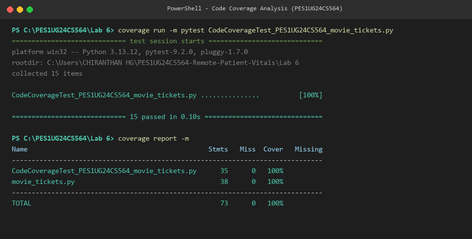

# Lab 6: Code and Branch Coverage Analysis

- **Student Name:** Chiranthan HG
- **SRN:** PES1UG24CS564
- **Module Under Test:** movie_tickets.py

---

## 1. Objective
- Understand the difference between code coverage (line coverage) and branch coverage.
- Use Python's coverage tool to measure, analyze, and improve test completeness.
- Practice writing test cases targeting statements, edge cases, and decision branches.

---

## 2. Code Coverage (Line Coverage)
Code coverage (statement/line coverage) measures whether every line of code was executed at least once during test execution.

### Test Suite:
- CodeCoverageTest_PES1UG24CS564_movie_tickets.py (and CodeCoverageTest_movie_tickets.py)

### Commands to Run:
`ash
coverage run -m pytest CodeCoverageTest_PES1UG24CS564_movie_tickets.py
coverage report -m
`

### Results Summary:
- **Total Statements:** 38
- **Missing Statements:** 0
- **Line Coverage Achieved:** **100%** (exceeds the required 90% threshold)

### Terminal Output Screenshot:

