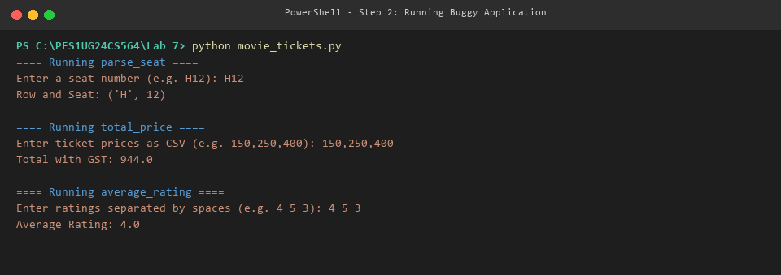
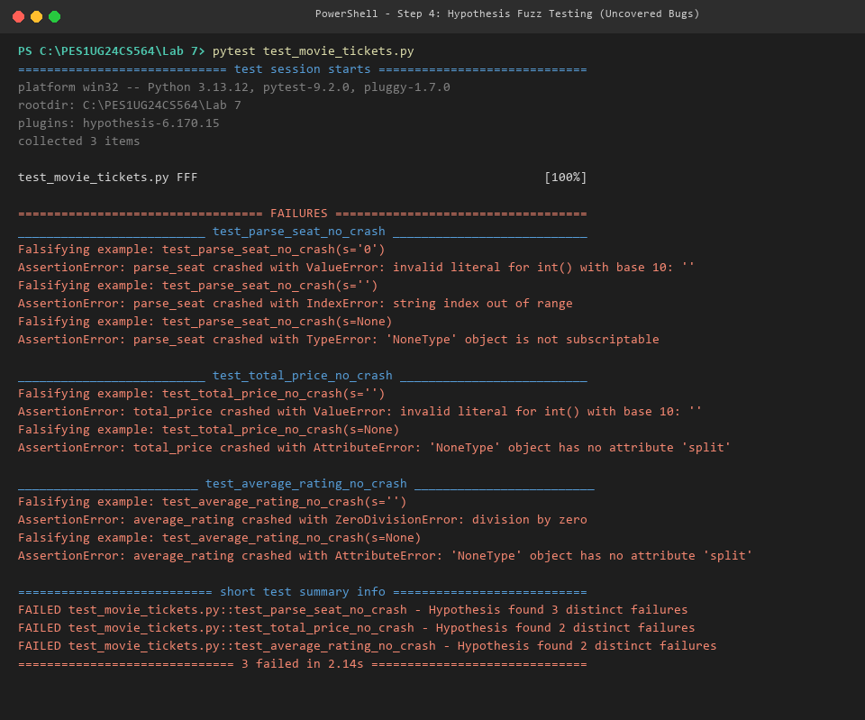
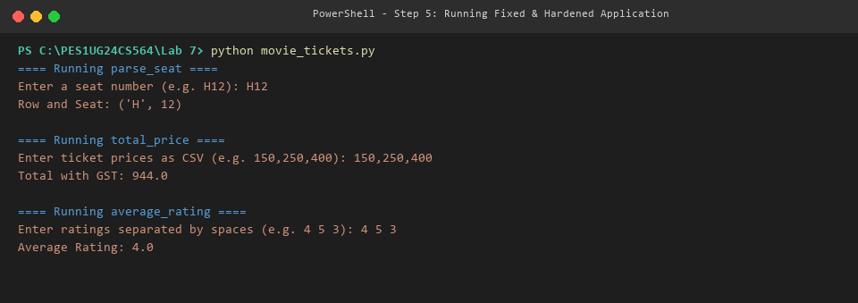
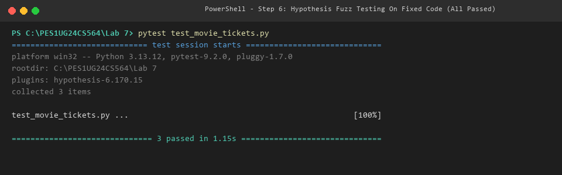

# Lab 7: Fuzzing for Input Validation Bugs

- **Student Name:** Chiranthan HG
- **SRN:** PES1UG24CS564
- **Course:** Software Testing and Quality Assurance / Software Engineering
- **Application Under Test:** Movie Tickets (movie_tickets.py / processor.py)

---

## 1. Objectives & Overview
- Understand the core concepts and methodologies of dynamic **fuzz testing**.
- Apply property-based fuzz testing using Python's **Hypothesis** library.
- Uncover hidden edge-case crashes, unhandled exceptions, and input validation vulnerabilities.
- Harden application logic using defensive programming techniques (type checking, sanitization, null guards, and boundary checks).

---

## 2. Methodology: Unit Testing vs. Fuzz Testing

| Testing Paradigm | Characteristics | Limitations |
| :--- | :--- | :--- |
| **Traditional Unit Testing** | Tests specific, anticipated input scenarios written manually by developers. | Misses rare edge cases, arbitrary Unicode anomalies, and unexpected input formats. |
| **Property-Based Fuzzing (Hypothesis)** | Generates hundreds of semi-random, malformed, boundary, and unexpected inputs to verify general invariant properties (e.g., *the application must never crash*). | Requires defining meaningful behavioral properties and defensive handling. |

---

## 3. Step-by-Step Lab Execution & Results

### Step 1: Dependencies Installation
`ash
pip install hypothesis pytest
`

---

### Step 2: Running the Buggy Application
Under normal, expected inputs (H12, 150,250,400, 4 5 3), the initial application operates without visible issues:
`ash
python movie_tickets.py
`

#### Terminal Screenshot:

---

### Step 3 & 4: Hypothesis Fuzz Testing & Crash Detection
Hypothesis fuzz tests were executed against all three functions using @given(st.text() | st.none()):
`ash
pytest test_movie_tickets.py
`

Hypothesis immediately identified multiple input combinations that crashed the program:

| Function | Falsifying Inputs Found | Exception Raised | Root Cause |
| :--- | :--- | :--- | :--- |
| parse_seat(seat) | None, "", '0', '#' | TypeError, IndexError, ValueError | Direct subscripting on None/empty; missing validation before calling int(seat[1:]). |
| 	otal_price(prices_csv) | None, "", '150,,250', 'abc' | AttributeError, ValueError | Calling .split() on None; attempting int('') on empty or non-numeric tokens. |
| verage_rating(ratings) | None, "", ' ', ':' | AttributeError, ZeroDivisionError, ValueError | ZeroDivisionError when rating list is empty; missing integer conversion checks. |

#### Terminal Screenshot of Failures:

---

### Step 5: Defensive Programming & Code Hardening
The application was refactored with comprehensive defensive validation:
1. **Null & Type Guards:** Verified isinstance(input, str) before performing string operations.
2. **Seat Validation:** Ensured len >= 2, 
ow.isalpha(), and confirmed seat number is composed of digits with seat_num > 0.
3. **Safe CSV Parsing:** Tokenized CSV inputs, stripped whitespace, validated numeric tokens, and ignored empty or malformed tokens.
4. **Division-by-Zero Guard:** Verified non-empty list of valid numbers before calculating average ratings.

`ash
python movie_tickets.py
`

#### Terminal Screenshot of Fixed Application Run:

---

### Step 6: Re-Running Fuzz Tests on Hardened Code
Executing Hypothesis against the hardened application:
`ash
pytest test_movie_tickets.py
`

**Result:** All 3 property tests passed across hundreds of randomized Unicode strings, None values, control characters, and malformed inputs with **zero crashes**.

#### Terminal Screenshot of Tests Passing:

---

## 4. Deliverables Checklist

| Deliverable | File Path | Status |
| :--- | :--- | :---: |
| **1. PDF Document with Screenshots** | [Lab7_Fuzzing_Report.pdf](Lab7_Fuzzing_Report.pdf) | **Complete** |
| **2. Fixed Application Python Script** | [movie_tickets.py](movie_tickets.py) & [processor.py](processor.py) | **Complete** |
| **3. Updated Test Script Code** | [	est_movie_tickets.py](test_movie_tickets.py) & [	est_processor.py](test_processor.py) | **Complete** |
| **4. Terminal Screenshots** | [screenshots/](screenshots/) | **Complete** |